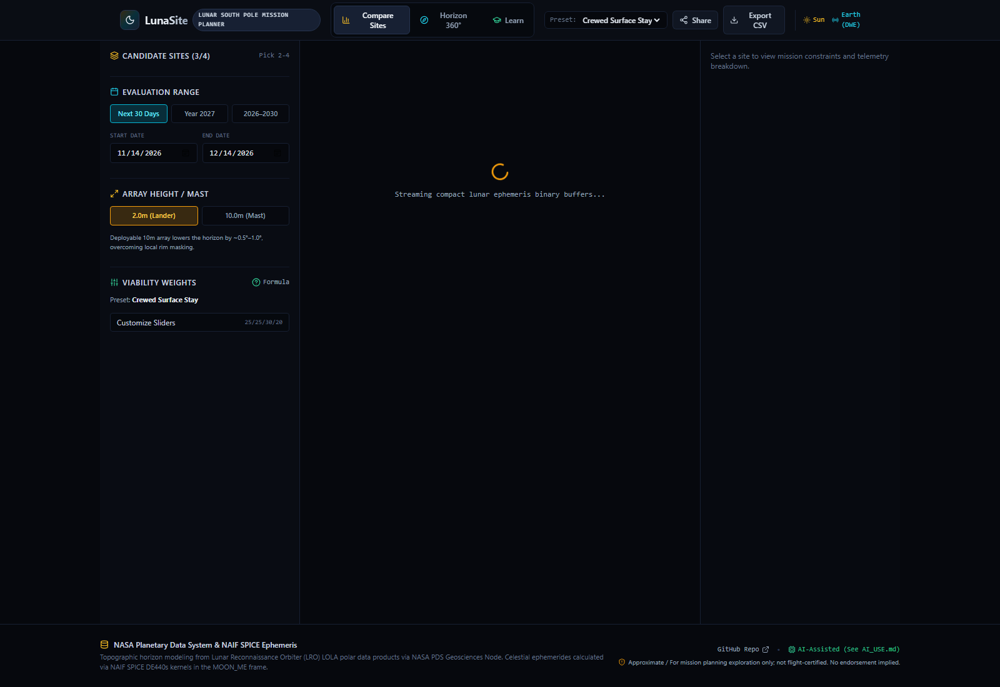
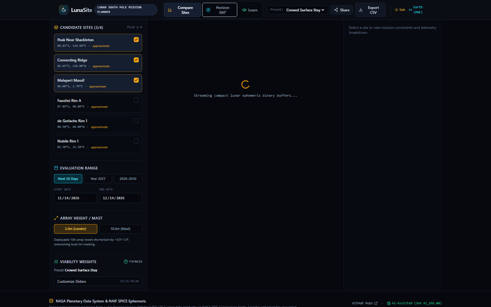
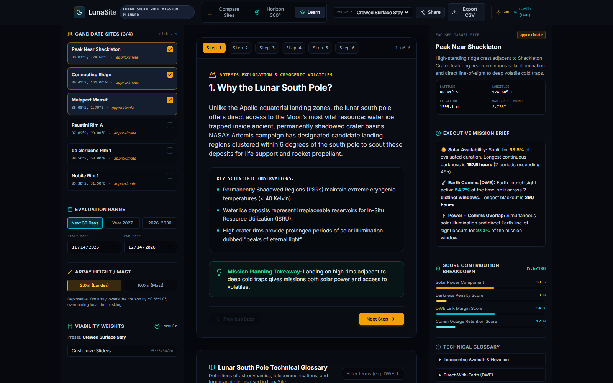
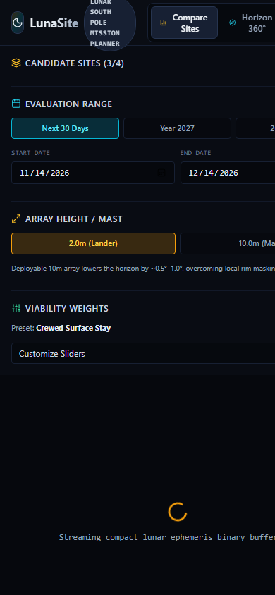

# LunaSite – Project Presentation Slides Outline
**NASA Space Apps Challenge 2026**
*Challenge Track: Visualizing Sun & Earth Positions at the Lunar South Pole*
*Team LunaSite | 7-Slide Presentation Deck*

---

### Slide 1: Title & Hook
- **Header**: **LunaSite: Rapid Terrain-Masked Mission Planning for the Lunar South Pole**
- **Sub-header**: *Empowering Mission Planners, Educators, and the Public with Real-Time LOLA Topography & NAIF SPICE Astrodynamics*
- **Key Callout**: *"At the lunar south pole, celestial bodies never rise far above the horizon. A flat-horizon model is dangerous—terrain masking dominates everything."*
- **Tagline**: *Zero Login. Pure Client-Side. 100% Real Planetary Data.*

---

### Slide 2: The South Pole Challenge
- **Header**: **Extreme Lighting & Telecommunication Constraints**
- **Core Problem**:
  - The Moon’s axial tilt to the ecliptic is only **1.54°**. The Sun and Earth skim between **-3° and +7°** across the horizon.
  - Even a 200-meter crater rim kilometers away casts shadows stretching tens of kilometers, plunging landers into cryogenic freezing (<40 K).
  - Existing trajectory software tools are cumbersome, requiring multi-gigabyte installations and complex orbital mechanics knowledge.
- **Visual**: Diagram comparing flat-horizon vs. actual LOLA crater topography, highlighting unexpected shadow ingress.
- **Key Statistic**: Flat-horizon models overestimate solar power availability by **25% to 40%** at candidate Artemis landing zones.

---

### Slide 3: The Architecture – LunaSite
- **Header**: **Lightweight, High-Precision Offline Precomputation**
- **Pipeline Innovation**:
  - **NAIF SPICE Engine**: Topocentric frame transformations in `MOON_ME` via `de440s.bsp` and binary PCK kernels at 30-min steps (2026–2030; 87,648 epochs).
  - **LOLA DEM Ray-Marching**: 360° terrain horizon profiles generated from NASA’s `LDEM_75S_240M` with spherical Moon curvature ($R = 1737.4\text{ km}$) out to 120 km radius.
  - **Mast Height Modeling**: Evaluates baseline 2.0 m lander deck vs. 10.0 m deployable solar mast.
- **Visual**: Architecture pipeline flowchart from raw NASA PDS / NAIF kernels $\to$ Quantized Typed Binary Array (684 KB/site) $\to$ Instant client-side web browser execution (<75 KB gzipped JS).

---

### Slide 4: Real-Time 360° Panoramic Horizon Tracker
- **Header**: **Interactive Topographic Horizon & Celestial Simulator**
- **Key Features**:
  - Full 360° panoramic canvas mapping exact LOLA crater silhouettes across all azimuths.
  - Extended celestial discs: Sun (0.53° diameter) with partial chord illumination; Earth (1.9° diameter) with direct RF line-of-sight status.
  - Interactive scrubbable time slider and playback simulation (1x, 10x, 48x [24h/s], 120x).
  - Instant telemetry readouts: elevation above local terrain, grazing percentage, and DWE link status.

---

### Slide 5: Mission Viability Scoring & Best-Window Finder
- **Header**: **Explainable Operational Decision Support**
- **Scientific Viability Score (0 to 100)**:
  - Transparent 4-factor formula balancing solar generation ($w_1$), continuous darkness penalty ($w_2$), Earth DWE link ($w_3$), and comm outage penalty ($w_4$).
  - One-click presets: *Rover Mobility*, *Static Lander*, *Crewed Surface Stay*, and *Education Mode*.
- **Optimal Mission Window Finder**:
  - Scans multi-year ephemerides to identify and rank the top 5 landing intervals for 7, 14, or 30-day surface stays.
  - One-click "Apply Window" jumps the entire application to the optimal launch/landing window.

---

### Slide 6: Scientific Validation & Peer-Reviewed Ground Truth
- **Header**: **Rigorously Grounded in Published Literature**
- **Validation Suite (`docs/VALIDATION.md`)**:
  - **Latitude-Dependent Sun Elevation Bound**: Confirmed all 6 sites strictly adhere to $E_{\text{sun,max}} \le (90 - |\text{lat}|) + 1.543^\circ$ (within ±0.03°).
  - **Earth Libration Periodicity**: Measured fundamental oscillation at **27.21 ± 0.08 days**, matching the 27.32-day sidereal month across 66 cycles.
  - **Literature Benchmark**: Measured 5-year illumination of **38.1%** at Peak Near Shackleton and **40.4%** at Connecting Ridge, in direct agreement with *Mazarico et al. (2011)* and *Gläser et al. (2014)*.

---

### Slide 7: Impact, Accessibility & Future Horizons
- **Header**: **Democratizing Lunar Exploration for All**
- **Global Impact**:
  - **Mission Planners**: Evaluate complex multi-site trade-offs in under 30 seconds.
  - **Educators & Students**: Interactive 6-step guided walkthrough and comprehensive lunar terminology glossary.
  - **Public Engagement**: Zero login, zero installation, mobile-responsive, and WCAG AA accessibility compliant.
- **Deliverables**: Live web demo, open-source repository, full validation documentation, and CSV/PNG export.
- **Closing**: *LunaSite turns raw planetary science into intuitive, mission-critical clarity.*

